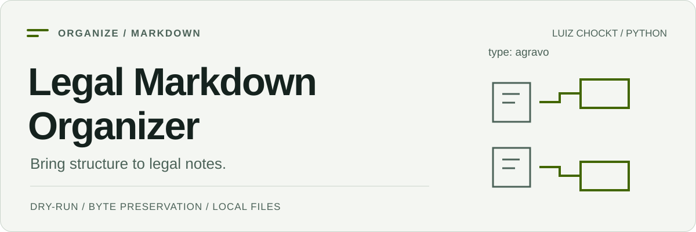

<picture>
  <source media="(prefers-color-scheme: dark) and (max-width: 600px)" srcset="./assets/cover-mobile-dark.svg">
  <source media="(max-width: 600px)" srcset="./assets/cover-mobile-light.svg">
  <source media="(prefers-color-scheme: dark)" srcset="./assets/cover-dark.svg">
  <source media="(prefers-color-scheme: light)" srcset="./assets/cover-light.svg">
  
</picture>

# Legal Markdown Organizer

[Português brasileiro](./README.pt-BR.md) · [Full reference](./docs/reference.md) · [Dry-run output](./docs/demo.txt)

[](https://github.com/LuizChockt/legal-markdown-organizer/actions/workflows/tests.yml)

**Turn a folder of legal Markdown files into clear document categories, with a preview before moving anything.**

Classifies top-level files by filename rules or a recognized `type` in simple front matter. Useful for Markdown document collections and copies of Obsidian vaults. No third-party runtime dependencies, AI services or document uploads.

## Quick start

Requires **Python 3.11+**. The source checkout runs without installing dependencies:

```bash
git clone https://github.com/LuizChockt/legal-markdown-organizer.git
cd legal-markdown-organizer
python main.py examples --dry-run
```

On Linux/macOS, use `python3` if that is your Python 3 command. The example documents are fictional. Dry-run reads and plans without creating directories or moving files.

The three included files produce these destinations:

```text
agravo_instrumento.md -> Agravos/agravo_instrumento.md
despacho.md -> Despachos/despacho.md
recurso_especial.md -> Recursos/recurso_especial.md
```

[See the complete recorded output](./docs/demo.txt).

## Organize your own collection

Use a backed-up copy first. Inspect the preview before running without `--dry-run`:

```powershell
# Windows PowerShell — replace this example path with your folder
python main.py "D:\Notes\Legal" --dry-run
python main.py "D:\Notes\Legal"
```

```bash
# Linux / macOS — replace this example path with your folder
python3 main.py ./legal-notes --dry-run
python3 main.py ./legal-notes
```

Moves preserve document bytes and add numbered suffixes when destinations already exist. There is **no undo command**. Moving a file can break relative links; the organizer does not rewrite them.

## Classification and scope

| Rule | Behavior |
| --- | --- |
| Recognized front matter `type` | Takes priority over the filename, e.g. `type: agravo`. |
| Filename rules | Accent-insensitive keywords with explicit category priority. |
| Unknown document | Falls back to `Outros`. |
| File selection | Top-level `.md` files; optional `.txt` with `--include-txt`. |
| Existing subfolders | Not scanned or reorganized. |
| Contents and links | Preserved as bytes; link destinations are not updated. |

Categories include petitions, orders, judgments, appeals, contracts and more, using Portuguese folder names. The front matter reader supports a small subset of YAML, not a general YAML parser. [All categories and rules](./docs/reference.md#legal-categories).

## Development and tests

Create a virtual environment:

```bash
python -m venv .venv
```

**Windows PowerShell**, without script activation:

```powershell
.\.venv\Scripts\python.exe -m pip install -e ".[dev]"
.\.venv\Scripts\python.exe -m pytest
.\.venv\Scripts\legal-organizer.exe --help
```

**Linux / macOS**:

```bash
.venv/bin/python -m pip install -e ".[dev]"
.venv/bin/python -m pytest
.venv/bin/legal-organizer --help
```

`pytest` is a development dependency. Tests cover category precedence, metadata, Unicode, collisions, dry-run snapshots, exact byte preservation, copy failures and real CLI execution. GitHub Actions runs Python **3.11 and 3.14** on **Linux, Windows and macOS**.

[Architecture and detailed usage](./docs/reference.md#project-structure) · [Contributing](./CONTRIBUTING.md) · [Security](./SECURITY.md) · [MIT License](./LICENSE)
