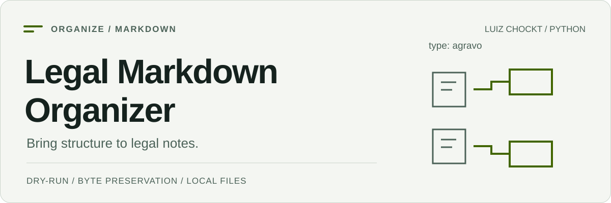

<picture>
  <source media="(prefers-color-scheme: dark) and (max-width: 600px)" srcset="./assets/cover-mobile-dark.svg">
  <source media="(max-width: 600px)" srcset="./assets/cover-mobile-light.svg">
  <source media="(prefers-color-scheme: dark)" srcset="./assets/cover-dark.svg">
  <source media="(prefers-color-scheme: light)" srcset="./assets/cover-light.svg">
  
</picture>

# Legal Markdown Organizer

[Português brasileiro](./README.pt-BR.md) · [Full reference](./docs/reference.md) · [Dry-run output](./docs/demo.txt)

[](https://github.com/LuizChockt/legal-markdown-organizer/actions/workflows/tests.yml)

**Turn a folder of legal Markdown files into clear document categories, with a preview before moving anything.**

Classifies top-level files by filename rules or a recognized `type` in simple front matter. Version **0.2.0** adds local execution history and safe undo. Useful for Markdown document collections and copies of Obsidian vaults. No third-party runtime dependencies, AI services or document uploads.

## Quick start

Requires **Python 3.11+**. The source checkout runs without installing dependencies:

```bash
git clone https://github.com/LuizChockt/legal-markdown-organizer.git
cd legal-markdown-organizer
python main.py examples --dry-run
```

On Linux/macOS, use `python3` if that is your Python 3 command. The example documents are fictional. Dry-run reads and plans without creating directories or moving files.

The three included files produce these destinations:

```text
agravo_instrumento.md -> Agravos/agravo_instrumento.md
despacho.md -> Despachos/despacho.md
recurso_especial.md -> Recursos/recurso_especial.md
```

[See the complete recorded output](./docs/demo.txt).

To install or update the released package on Windows, without Git or script activation:

```powershell
py -m pip install --upgrade "https://github.com/LuizChockt/legal-markdown-organizer/releases/download/v0.2.0/legal_markdown_organizer-0.2.0-py3-none-any.whl"
py -m legal_organizer --version
```

Use `python`/`python3` instead of `py` where appropriate. After installation,
`legal-organizer PATH` and `python -m legal_organizer PATH` expose the same CLI
as `python main.py PATH` from a checkout. This release is on GitHub, not PyPI.

## Organize your own collection

Use a backed-up copy first. Inspect the preview before running without `--dry-run`:

```powershell
# Windows PowerShell — replace this example path with your folder
python main.py "D:\Notes\Legal" --dry-run
python main.py "D:\Notes\Legal"
```

```bash
# Linux / macOS — replace this example path with your folder
python3 main.py ./legal-notes --dry-run
python3 main.py ./legal-notes
```

Moves preserve document bytes and add numbered suffixes when destinations already exist. Moving a file can break relative links; the organizer does not rewrite them.

## History and undo

```powershell
# From a checkout; all paths and documents in examples are fictional
python main.py "D:\Notes\Legal" --history
python main.py "D:\Notes\Legal" --undo-last --dry-run
python main.py "D:\Notes\Legal" --undo-last
```

Each real attempt receives a unique execution ID and a local JSON manifest in
`PATH/.legal-organizer/`. Empty runs and previews do not create history.
`--undo-last` selects the latest execution not fully undone, including partial
or interrupted attempts. It restores unchanged files only, never overwrites an
original path, and leaves conflicts pending for a retry. Empty category folders
are retained. Exit code `1` means a pending error; `2` means invalid usage/path;
`130` means a keyboard interruption. Existing commands remain compatible.

**Undo is not a backup.** SHA-256 and file identities detect edits and replacements;
ambiguous partial copies require manual review. Close editors and sync clients
before real moves. Do not edit, publish or discard recovery manifests while a run
is pending. This repository and the generated history `.gitignore` exclude them;
ignore rules cannot protect files deliberately force-added to Git.
[Manifest format, recovery steps and filesystem limits](./docs/history.md).

## Classification and scope

| Rule | Behavior |
| --- | --- |
| Recognized front matter `type` | Takes priority over the filename, e.g. `type: agravo`. |
| Filename rules | Accent-insensitive keywords with explicit category priority. |
| Unknown document | Falls back to `Outros`. |
| File selection | Top-level `.md` files; optional `.txt` with `--include-txt`. |
| Existing subfolders | Not scanned or reorganized. |
| Contents and links | Preserved as bytes; link destinations are not updated. |

Categories include petitions, orders, judgments, appeals, contracts and more, using Portuguese folder names. The front matter reader supports a small subset of YAML, not a general YAML parser. [All categories and rules](./docs/reference.md#legal-categories).

## Development and tests

Create a virtual environment:

```bash
python -m venv .venv
```

**Windows PowerShell**, without script activation:

```powershell
.\.venv\Scripts\python.exe -m pip install -e ".[dev]"
.\.venv\Scripts\python.exe -m pytest
.\.venv\Scripts\legal-organizer.exe --help
```

**Linux / macOS**:

```bash
.venv/bin/python -m pip install -e ".[dev]"
.venv/bin/python -m pytest
.venv/bin/legal-organizer --help
```

`pytest` is a development dependency. Tests cover classification, Unicode,
collisions, history, undo, exact bytes, write failures, process termination,
concurrent edits, unsafe paths and real CLI execution. GitHub Actions runs Python
**3.11 and 3.14** on **Linux, Windows and macOS**, plus **3.12 and 3.13** on Linux.
Every job builds and exercises the installed wheel outside the checkout.

[Changelog](./CHANGELOG.md) · [0.2.0 release notes](./docs/releases/v0.2.0.md)

[Architecture and detailed usage](./docs/reference.md#project-structure) · [Contributing](./CONTRIBUTING.md) · [Security](./SECURITY.md) · [MIT License](./LICENSE)
