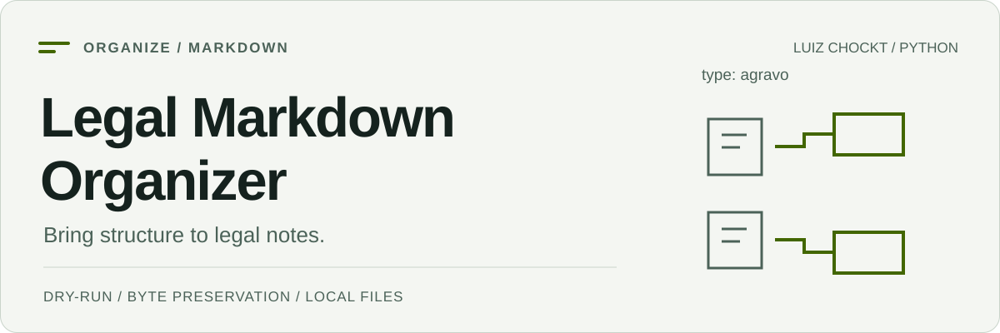

<picture>
  <source media="(prefers-color-scheme: dark) and (max-width: 600px)" srcset="./assets/cover-mobile-dark.svg">
  <source media="(max-width: 600px)" srcset="./assets/cover-mobile-light.svg">
  <source media="(prefers-color-scheme: dark)" srcset="./assets/cover-dark.svg">
  <source media="(prefers-color-scheme: light)" srcset="./assets/cover-light.svg">
  
</picture>

# Legal Markdown Organizer

[English](./README.md) · [Referência completa em inglês](./docs/reference.md) · [Saída do dry-run](./docs/demo.txt)

[](https://github.com/LuizChockt/legal-markdown-organizer/actions/workflows/tests.yml)

**Transforma uma pasta de arquivos jurídicos Markdown em categorias claras, com uma prévia antes de mover qualquer documento.**

Classifica arquivos do primeiro nível por nome ou por um `type` reconhecido no front matter simples. A versão **0.2.0** acrescenta histórico local e desfazer seguro. Útil para acervos Markdown e cópias de vaults Obsidian. Não utiliza dependências de execução de terceiros, serviços de IA nem upload de documentos.

## Início rápido

Requer **Python 3.11+**. O código funciona sem instalar dependências:

```bash
git clone https://github.com/LuizChockt/legal-markdown-organizer.git
cd legal-markdown-organizer
python main.py examples --dry-run
```

No Linux/macOS, utiliza `python3` se esse for o comando do Python 3. Os documentos de exemplo são fictícios. O dry-run lê e planeja sem criar pastas nem mover arquivos.

Os três exemplos produzem estes destinos:

```text
agravo_instrumento.md -> Agravos/agravo_instrumento.md
despacho.md -> Despachos/despacho.md
recurso_especial.md -> Recursos/recurso_especial.md
```

[Saída completa registrada](./docs/demo.txt).

Para instalar ou atualizar a versão publicada no Windows, sem precisar de Git ou ativação de scripts:

```powershell
py -m pip install --upgrade "https://github.com/LuizChockt/legal-markdown-organizer/releases/download/v0.2.0/legal_markdown_organizer-0.2.0-py3-none-any.whl"
py -m legal_organizer --version
```

Usa `python`/`python3` em vez de `py` quando for adequado. Após a instalação,
`legal-organizer PASTA` e `python -m legal_organizer PASTA` oferecem a mesma CLI
de `python main.py PASTA` no repositório. A distribuição está no GitHub, não no PyPI.

## Organizar teu acervo

Começa por uma cópia com backup. Confere a prévia antes de executar sem `--dry-run`:

```powershell
# Windows PowerShell — substitui o caminho pela tua pasta
python main.py "D:\Notes\Legal" --dry-run
python main.py "D:\Notes\Legal"
```

```bash
# Linux / macOS — substitui o caminho pela tua pasta
python3 main.py ./legal-notes --dry-run
python3 main.py ./legal-notes
```

Os movimentos preservam os bytes e acrescentam sufixos numéricos em colisões. Mover um arquivo pode quebrar links relativos; o organizador não os reescreve.

## Histórico e desfazer

```powershell
# No repositório; os caminhos e documentos de exemplo são fictícios
python main.py "D:\Notes\Legal" --history
python main.py "D:\Notes\Legal" --undo-last --dry-run
python main.py "D:\Notes\Legal" --undo-last
```

Cada tentativa real recebe um identificador único e um manifesto JSON local em
`PASTA/.legal-organizer/`. Execuções vazias e simulações não criam histórico.
`--undo-last` seleciona a execução mais recente ainda não totalmente desfeita,
inclusive tentativas parciais ou interrompidas. Restaura somente arquivos
inalterados, nunca sobrescreve o caminho original e deixa conflitos pendentes para
nova tentativa. As pastas de categorias vazias são mantidas. O código de saída
`1` indica pendência; `2`, uso/caminho inválido; `130`, interrupção pelo teclado.
Os comandos antigos continuam funcionando.

**Desfazer não substitui backup.** SHA-256 e identidade dos arquivos detectam
alterações e substituições; cópias parciais ambíguas exigem conferência manual.
Fecha editores e sincronizadores antes de mover arquivos. Não edita, publica nem
descarta os manifestos enquanto houver pendências. O `.gitignore` deste projeto
e o gerado dentro do histórico os excluem; regras de exclusão não protegem
arquivos adicionados deliberadamente com força ao Git.
[Formato, recuperação e limites dos sistemas de arquivos](./docs/history.md).

## Classificação e escopo

| Regra | Comportamento |
| --- | --- |
| `type` reconhecido no front matter | Tem prioridade sobre o nome, como `type: agravo`. |
| Nome do arquivo | Palavras-chave sem distinção de acentos, com prioridade explícita. |
| Documento desconhecido | Categoria `Outros`. |
| Seleção de arquivos | `.md` do primeiro nível; `.txt` opcional com `--include-txt`. |
| Subpastas existentes | Não são percorridas nem reorganizadas. |
| Conteúdo e links | Bytes preservados; destinos dos links não são atualizados. |

As categorias incluem petições, despachos, sentenças, agravos, recursos, contratos e outras. O leitor de front matter aceita apenas um subconjunto de YAML. [Categorias e regras completas](./docs/reference.md#legal-categories).

## Desenvolvimento e testes

Cria um ambiente virtual:

```bash
python -m venv .venv
```

**Windows PowerShell**, sem ativar scripts:

```powershell
.\.venv\Scripts\python.exe -m pip install -e ".[dev]"
.\.venv\Scripts\python.exe -m pytest
.\.venv\Scripts\legal-organizer.exe --help
```

**Linux / macOS**:

```bash
.venv/bin/python -m pip install -e ".[dev]"
.venv/bin/python -m pytest
.venv/bin/legal-organizer --help
```

`pytest` é uma dependência de desenvolvimento. A suíte verifica classificação,
Unicode, colisões, histórico, desfazer, preservação exata dos bytes, falhas de
escrita, encerramento de processos, edições concorrentes, caminhos inseguros e a
CLI real. O GitHub Actions usa Python **3.11 e 3.14** em **Linux, Windows e macOS**,
além de **3.12 e 3.13** no Linux. Cada combinação constrói e testa o pacote
instalado fora do repositório.

[Histórico de versões](./CHANGELOG.md) · [Notas da versão 0.2.0](./docs/releases/v0.2.0.md)

[Arquitetura e uso detalhado](./docs/reference.md#project-structure) · [Contribuição](./CONTRIBUTING.md) · [Segurança](./SECURITY.md) · [Licença MIT](./LICENSE)
